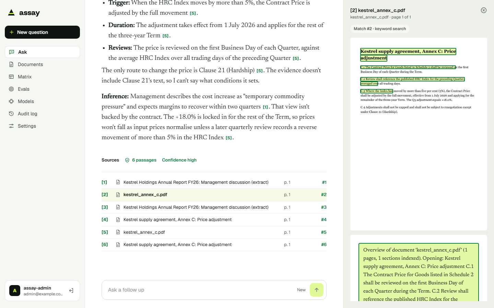
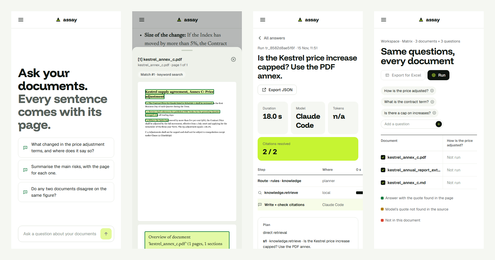
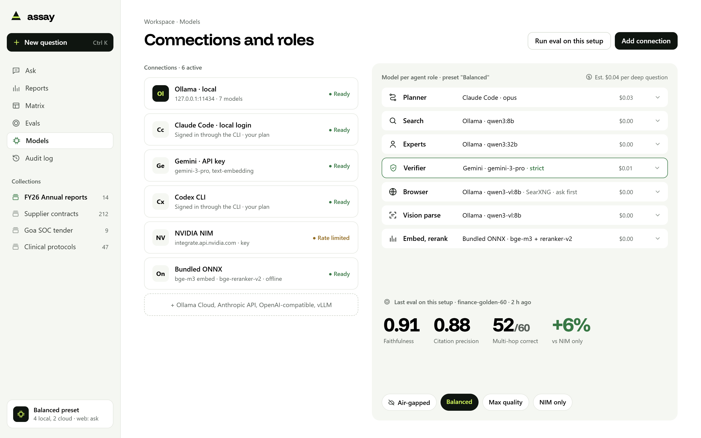
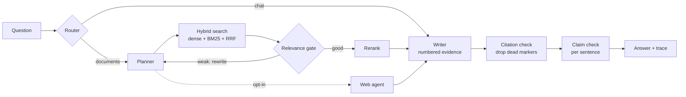

<p align="center">
  
</p>

<p align="center">
  <b>Ask hard questions of long documents. Check every sentence of the answer against the page it came from.</b>
</p>

<p align="center">
  <a href="LICENSE"></a>
  <a href="https://github.com/mrigankad/Assay/releases"></a>
  
  
  
</p>

<p align="center">
  <a href="#quick-start">Quick start</a> ·
  <a href="#features">Features</a> ·
  <a href="#bring-any-model">Models</a> ·
  <a href="#how-it-works">How it works</a> ·
  <a href="#configuration">Configuration</a> ·
  <a href="#api">API</a> ·
  <a href="#status">Status</a>
</p>

Assay is an open-source research engine for long documents: filings, contracts, tenders, policies. You ask a question; it plans the search, reads the evidence and writes an answer where every sentence carries a citation. Then it checks each sentence against the passage it cites and shows you which ones hold up. Click any citation and the real PDF page opens with the quoted lines boxed.

It runs on your machine or your cloud, with whichever models you already have: an API key, a cloud account, Ollama, or the Claude Code / Codex / Gemini CLI you're already signed in to.

<p align="center"></p>

## Why Assay

Most document chat tools stop at "source: contract.pdf". That leaves you to find the sentence yourself, and to trust that the model didn't change a number on the way.

| | Typical document chat | Assay |
|---|---|---|
| Citation points to | the file | the passage, with the lines boxed on the page |
| Citations to nothing | shown anyway | removed before you see the answer |
| Checking the answer | read the sources yourself | each sentence checked: figures must appear in the cited passage |
| Same question, 20 documents | 20 chats | one matrix, one export |
| Which model | the one it ships with | any of 73 providers, a different one per role |
| What happened | gone | a trace per answer: plan, sources, model, tokens, timing |

## Quick start

You need Python 3.12+, Node 20+ and one model source: an API key, a cloud login, Ollama, or a signed-in Claude Code / Codex / Gemini CLI.

**1. Get the code and the backend dependencies**

```bash
git clone https://github.com/mrigankad/Assay.git && cd Assay
cp .env.example .env              # add a key here, or skip if Ollama / a cloud login / a CLI is already set up

cd backend
python -m venv .venv
. .venv/bin/activate              # Windows: .venv\Scripts\activate
pip install uv && uv pip install -r requirements.txt   # uv resolves in seconds; plain pip works but is slow
```

**2. Start the API** (SQLite and an embedded vector store: no Docker, no database server)

```bash
cd .. && make dev-local
# or, without make (e.g. Windows Git Bash), from backend/:
USE_SQLITE=true QDRANT_MODE=path REDIS_ENABLED=false INGESTION_MODE=inline python -m uvicorn main:app --port 8000
```

**3. Start the UI**

```bash
cd frontend && npm install && npm run dev      # http://localhost:3000
```

**4. First run.** The first account you create becomes the admin. The setup screen shows every model Assay found; pick one for answers. Upload a document under **Documents** (try `samples/kestrel_annex_c.pdf`) and ask *"Is the price increase capped?"*

> **Using a CLI login instead of a key?** Set `ASSAY_ENABLE_CLAUDE_CODE=1` (or `ASSAY_ENABLE_CODEX_CLI=1`, `ASSAY_ENABLE_GEMINI_CLI=1`) before starting the API. These use your personal subscription and are meant for personal use.
>
> **Don't want any model running on your laptop?** Set `ASSAY_LOCAL_COMPUTE=0`. Every call then goes to a remote provider or Ollama Cloud. With no embedding model, search falls back to keywords (BM25) and still works.

**Full stack** with Postgres, Redis, Qdrant and a background ingestion worker: `cp .env.example .env && make init` (Docker Compose).

## Features

### Cited on the page
Click a citation and the original PDF page opens with the quoted lines boxed, next to the passage text. Pages are located on demand from the stored original, so documents indexed before this feature get highlights too.

### Claim by claim
Under every answer, each sentence is checked against the passages it cites, with no extra model call:

- **Backed** · every figure in the sentence appears in the cited passage and most of the wording matches
- **Loosely backed** · figures match but the wording is a paraphrase or the model's own inference
- **Not found** · a figure isn't in the cited passage; the panel names it
- **No citation** · a sentence states a figure with no source

<p align="center"></p>

The check compares words and numbers, not meaning. It reliably catches changed numbers and unsourced figures; "loosely backed" means *worth a look*, not *wrong*.

### Matrix
The same questions across every document. Each cell has the answer, the page, and whether the model's quote was found in the source. Export for Excel.

<p align="center"></p>

### Web research (opt-in)
`WEB_MODE=ask` adds a **Web** toggle next to the question box; `auto` lets the planner decide when documents aren't enough. Uses Tavily, Brave, Exa or your own SearXNG. Respects robots.txt and domain allow/block lists, treats page text as data rather than instructions, and saves a snapshot of every page it cites.

### Sign-in and access
- The first account is the admin; sign-up is then closed unless `ALLOW_SIGNUP=true`.
- Single sign-on with any OpenID Connect provider (Entra ID, Okta, Google, Keycloak, Auth0) through `OIDC_ISSUER` and `OIDC_CLIENT_ID`, with PKCE and optional `SSO_ALLOWED_DOMAINS`.
- Every chunk carries access-control principals; connectors (SharePoint, Google Drive, Confluence, S3, web, folders) sync source permissions.

### Audit log and evals
Every answer keeps its plan, retrieval steps, sources, model, tokens and timing, shown as a timeline and exportable as JSON. Admins can run named eval datasets and compare saved runs.

### Works on a phone
Every screen fits phone width. Evidence opens as a bottom sheet; the audit log shows one answer at a time.

<p align="center"></p>

## Bring any model

<p align="center"></p>

On start, Assay looks for:

- **API keys** in the environment: OpenAI, Anthropic, Gemini, Mistral, Cohere, Groq, Together, Fireworks, DeepSeek, xAI, OpenRouter and [60 more](docs/PROVIDERS.md).
- **Cloud logins**: AWS (profiles, SSO, roles) for Bedrock and SageMaker, Azure OpenAI and AI Foundry (keys or Entra ID), Google Vertex (ADC), Oracle OCI, IBM watsonx, Alibaba, Databricks, Snowflake, Cloudflare.
- **Local servers**, found by probing their ports: Ollama, LM Studio, vLLM, SGLang, llama.cpp, LocalAI, Jan, GPT4All, KoboldCpp, text-generation-webui, Xinference, TGI/TEI, Triton, Infinity, Docker Model Runner, MLX.
- **Built-in offline embeddings and reranking** (ONNX), so retrieval works without a key.
- **Vendor CLIs** (Claude Code, Codex, Gemini CLI) using your own login, off until you opt in.

Each role (planner, search, experts, verifier, browser, vision, writer, embeddings, rerank) can use a different model. Assay picks defaults by capability; change them on the **Models** screen or with `ASSAY_MODEL_<ROLE>`. Admins can block providers workspace-wide under **Settings**.

<p align="center"></p>

## How it works



| Layer | What's there |
|---|---|
| **Ingestion** | PDF, DOCX, Markdown, HTML, CSV and text; heading-aware chunks, tables kept whole, page locations, per-document outline chunks for overview questions |
| **Retrieval** | Dense and BM25 sparse vectors fused with Reciprocal Rank Fusion, reranking, a relevance gate that rewrites and retries weak queries; keyword-only mode when no embedding model exists |
| **Agents** | Planner, search, 50 domain personas, writer, verifier, optional browser agent |
| **Data** | `data.query` answers questions over SQL databases through a read-only, policy-checked gateway |
| **Interop** | Assay is an MCP server at `/mcp`, and can use any MCP knowledge server (including Azure AI Search / Foundry IQ) as its backend |
| **Ops** | OpenTelemetry traces, per-answer token accounting, an offline eval harness, Docker Compose |

Built with FastAPI, Qdrant, SQLite or Postgres, LiteLLM and pypdfium2; the UI is React, Vite and Tailwind.

## Configuration

Everything lives in `.env`; [`.env.example`](.env.example) lists every option with comments. The ones you're most likely to touch:

| Variable | Default | What it does |
|---|---|---|
| `OPENAI_API_KEY`, `ANTHROPIC_API_KEY`, … | | Any provider key; detected on start |
| `ASSAY_MODEL_<ROLE>` | auto | Pin a role to a model, e.g. `ASSAY_MODEL_WRITER=anthropic/claude-sonnet-5-5` |
| `ASSAY_LOCAL_COMPUTE` | `1` | `0` keeps all inference off this machine |
| `ASSAY_ENABLE_CLAUDE_CODE` | off | Also `_CODEX_CLI`, `_GEMINI_CLI`: use a signed-in CLI as a model |
| `WEB_MODE` | `off` | `ask` adds a Web toggle; `auto` lets the planner decide |
| `TAVILY_API_KEY`, `BRAVE_API_KEY`, `EXA_API_KEY`, `SEARXNG_URL` | | Web search backend (any one) |
| `ALLOW_SIGNUP` | `false` | Let people create accounts after the first admin |
| `OIDC_ISSUER`, `OIDC_CLIENT_ID` | | Single sign-on |
| `SSO_ALLOWED_DOMAINS` | | Only these email domains may join through SSO |
| `USE_SQLITE`, `QDRANT_MODE=path` | | Run without Postgres or a Qdrant server |
| `ACL_ENFORCEMENT` | `true` | Filter every search by the user's access |

## API

Interactive docs at `http://localhost:8000/docs`. Every route is also served under `/v1`. The main ones:

| Route | Purpose |
|---|---|
| `POST /chat` | Ask. SSE stream of `progress`, `evidence`, `answer_delta`, `done` (with citations and claim checks). `"use_web": true` to include the web |
| `POST /ingest` | Add a document |
| `GET /documents/{id}/pages/{n}.png` | Render a PDF page |
| `POST /documents/{id}/pages/{n}/locate` | Boxes for a passage on that page |
| `POST /matrix` | Questions × documents |
| `GET /providers` | What was detected (`?refresh=true` to rescan) |
| `GET /providers/roles` | The model each role uses right now |
| `POST /providers/test` | `{"role": "writer"}` sends a one-word prompt and reports latency |
| `GET /traces` | Your answer history (admins see everyone's) |
| `GET /auth/methods` | Password and SSO options for the sign-in page |

Assay also speaks **MCP** at `/mcp`, so Claude Desktop, Claude Code or any MCP client can query your documents with citations.

## Development

```bash
cd backend && python -m pytest -q          # ~290 tests, a minute or two
cd frontend && npx tsc --noEmit            # type check
python scripts/gen_providers_doc.py        # regenerate docs/PROVIDERS.md from the catalogue
```

```
backend/src/
  providers/      catalogue, detection, routing, CLI backends
  orchestrator/   router, planner, executor, synthesizer, claim check
  web/            search backends and the page reader
  api/v1/         FastAPI routes
frontend/src/     pages, components, stores
docs/             providers, architecture, research
samples/          documents to try
```

## Status

Assay was previously named Dexter (this repository, renamed) and grew out of the Bodham rebuild of it.

- **Tested live:** chat through the Claude Code CLI login and Ollama Cloud, keyword-only ingestion and answers, page highlighting, the claim check, the matrix, and the full account flow.
- **Covered by tests, not yet run against a live service:** the web agent (needs a search key) and SSO (needs an identity provider).
- **Provider detection** covers 73 providers and is unit-tested; most have not been called live. If one doesn't connect, open an issue with the provider name and the error from the **Models** screen.

## Security

Assay is meant to be self-hosted. Before exposing it beyond your machine: set a strong `JWT_SECRET_KEY`, keep `ALLOW_SIGNUP=false` or use SSO with `SSO_ALLOWED_DOMAINS`, and leave `ACL_ENFORCEMENT` on. Web pages read by the browser agent are treated as quoted data, never as instructions. Please report vulnerabilities privately through GitHub security advisories rather than public issues.

## Licence

[MIT](LICENSE). Provider logos come from [LobeHub Icons](https://github.com/lobehub/lobe-icons) (MIT) and [simple-icons](https://simpleicons.org) (CC0) and remain trademarks of their owners.
