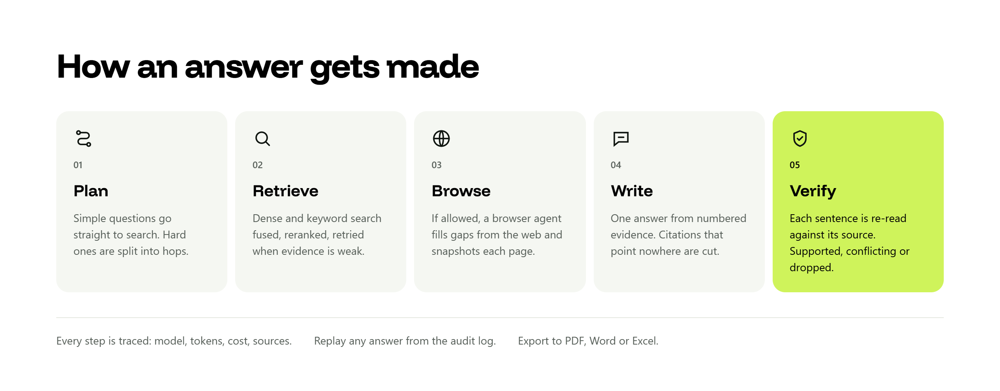
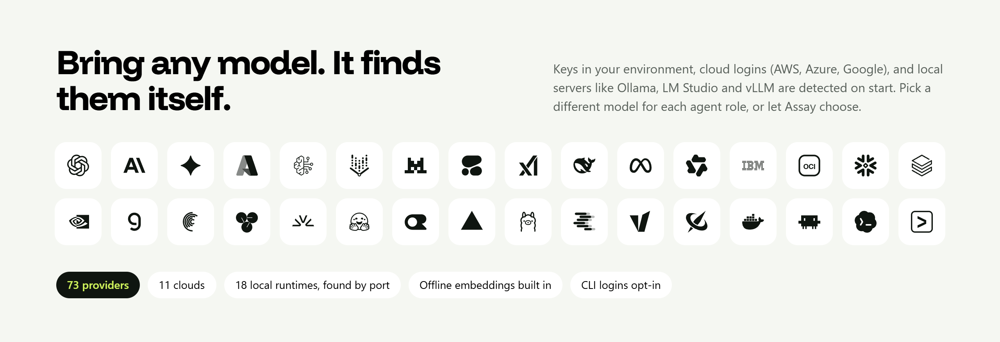
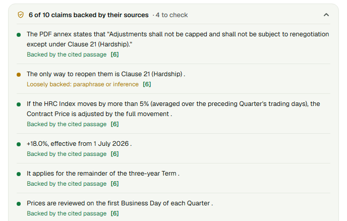
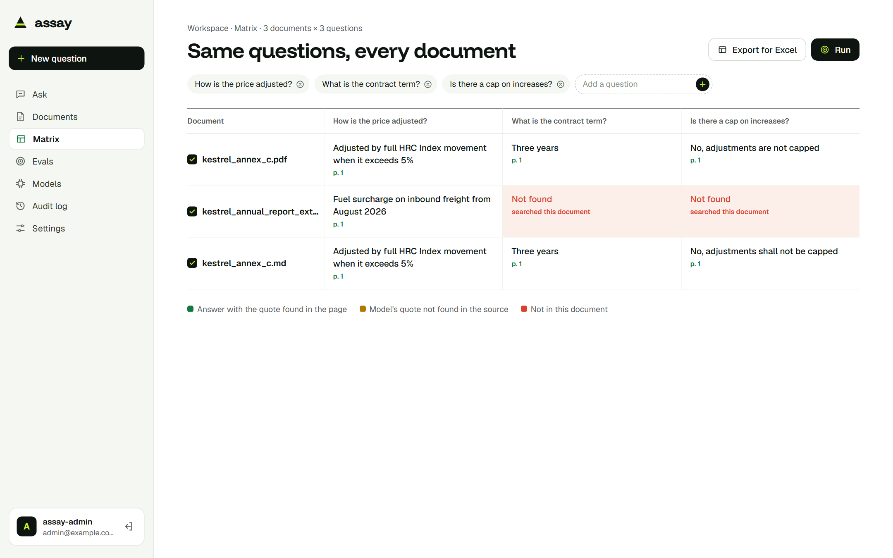

<p align="center">
  
</p>

Assay is an open-source research engine for long documents. Ask it a hard question about a 400-page filing, a stack of contracts or a tender, and it plans the search, reads the evidence, checks each sentence of its answer against the page it came from, and drops anything it can't support. It runs on your machine or your cloud, with whichever models you already have.

<p align="center"></p>

## Why it exists

Most document chat tools cite a document. Assay cites the sentence, shows the region of the page, and tells you when two sources disagree. Every answer keeps a trace (plan, sources, model, tokens, cost) you can replay later.

<p align="center"></p>

## Bring any model

<p align="center"></p>

On start, Assay looks for:

- **API keys** in the environment: OpenAI, Anthropic, Gemini, Mistral, Cohere, Groq, Together, Fireworks, DeepSeek, xAI, OpenRouter and [60 more](docs/PROVIDERS.md).
- **Cloud logins**: AWS (profiles, SSO, roles) for Bedrock and SageMaker, Azure OpenAI and AI Foundry (keys or Entra ID), Google Vertex (ADC), Oracle OCI, IBM watsonx, Alibaba, Databricks, Snowflake, Cloudflare.
- **Local servers**, found by probing their ports: Ollama, LM Studio, vLLM, SGLang, llama.cpp, LocalAI, Jan, GPT4All, KoboldCpp, text-generation-webui, Xinference, TGI/TEI, Triton, Infinity, Docker Model Runner, MLX.
- **Built-in offline embeddings and reranking** (ONNX), so retrieval works with no key at all.
- **Vendor CLIs** (Claude Code, Codex, Gemini CLI) with your own login. These are off until you opt in, and are for personal use only.

Each agent role (planner, search, experts, verifier, browser, vision, writer, embeddings, rerank) can use a different model. Assay picks sensible defaults; override any role with `ASSAY_MODEL_<ROLE>`.

<p align="center"></p>

## Quick start

You need Python 3.12+, Node 20+ and one model source (an API key, a cloud login, or Ollama running locally).

```bash
git clone https://github.com/mrigankad/Dexter-retrival-engine.git assay && cd assay
cp .env.example .env            # add a key, or skip this if Ollama / a cloud login is already set up

cd backend
python -m venv .venv && . .venv/bin/activate     # Windows: .venv\Scripts\activate
pip install -r requirements.txt
cd .. && make dev-local          # API on http://localhost:8000 (SQLite + embedded Qdrant, no Docker)

cd frontend && npm install && npm run dev        # UI on http://localhost:3000
```

Then open **Models** to see what was found, upload documents under **Documents**, and ask.

Full stack with Postgres, Redis, Qdrant and a worker: `cp .env.example .env && make init`.

## What's inside

| | |
|---|---|
| **Retrieval** | Dense + BM25 sparse vectors fused with Reciprocal Rank Fusion, reranking, a relevance gate that rewrites and retries weak queries, per-document outline chunks for overview questions. |
| **Ingestion** | PDF, DOCX, Markdown, HTML, CSV and text, with heading-aware chunks, tables kept whole and page-level locations. |
| **Agents** | Planner, search, 50 domain personas, verifier and writer. A browser agent (opt-in) reads the web and snapshots every page it cites. |
| **Answers** | One grounded answer from numbered evidence. Citations that point nowhere are removed. Confidence is derived, not asserted. |
| **Access** | Every chunk carries ACL principals. Local JWT auth or Microsoft Entra ID. Connectors sync source permissions (SharePoint, Google Drive, Confluence, S3, web, folders). |
| **Data** | `data.query` answers questions over SQL databases through a read-only, policy-checked gateway. |
| **Interop** | Assay is an MCP server at `/mcp`, and can use any MCP knowledge server (including Azure AI Search / Foundry IQ) as its backend. |
| **Ops** | OpenTelemetry traces, per-answer token and cost accounting, an offline eval harness, Docker Compose. |

## Features

**Cited on the page.** Click a citation and the real PDF page opens with the quoted lines boxed. Works for documents indexed before the feature existed.

**Claim by claim.** Under each answer, every sentence is checked against the passages it cites: figures must appear in the source and the wording must mostly match. Sentences that are inference, cite the wrong passage, or state a figure with no citation are flagged. No extra model call.

<p align="center"></p>

**Matrix.** Ask the same questions of every document. Each cell shows the answer, the page, and whether the model's quote was found in the source.

<p align="center"></p>

**Web research (opt-in).** `WEB_MODE=ask` adds a "Search the web" toggle; `auto` lets the planner decide. Works with Tavily, Brave, Exa or your own SearXNG, respects robots.txt and domain allow/block lists, and saves a snapshot of every page it cites.

**Sign-in.** The first account becomes admin; after that, sign-up is closed unless `ALLOW_SIGNUP=true`. Any OpenID Connect provider (Entra ID, Okta, Google, Keycloak, Auth0) works through `OIDC_ISSUER` and `OIDC_CLIENT_ID`, with PKCE and optional `SSO_ALLOWED_DOMAINS`.

**Audit log and evals.** Every answer keeps its plan, sources, model, tokens and timing, exportable as JSON. Admins can run named eval datasets and compare saved runs.

**No machine learning on your laptop if you don't want it.** `ASSAY_LOCAL_COMPUTE=0` keeps every model call remote (API keys, Ollama Cloud, or the Claude Code / Codex / Gemini CLI logins). With no embedding model available, Assay falls back to keyword (BM25) search, so it still works with only a chat model.

**Phones.** Every screen works at phone width; evidence opens as a bottom sheet.

<p align="center"></p>

## API

- `GET /api/providers` · what was detected · `?refresh=true` to rescan
- `GET /api/providers/roles` · the model each role uses right now
- `POST /api/providers/test` · `{"role": "verifier"}` sends a one-word prompt and reports latency
- `POST /api/chat` · SSE stream of `progress`, `evidence`, `answer_delta`, `done`; `"use_web": true` to include the web
- `GET /api/documents/{id}/pages/{n}.png` and `POST .../locate` · the page image and the boxes for a passage
- `GET /api/auth/methods` · password and SSO options for the sign-in page
- Swagger at `/docs`

## Status

Assay grew out of [Dexter](https://github.com/mrigankad/Dexter-retrival-engine) and the Bodham rebuild of it. Tested live: chat through the Claude Code CLI login and Ollama Cloud, keyword-only ingestion and answers, page highlighting, the matrix, and the full account flow. Covered by tests but not yet tried against a live service: the web agent (needs a search key) and SSO (needs an identity provider). Provider detection covers 73 providers and is unit-tested; most have not been called live.

## Licence

MIT. Provider logos come from [LobeHub Icons](https://github.com/lobehub/lobe-icons) (MIT) and [simple-icons](https://simpleicons.org) (CC0) and remain trademarks of their owners.
